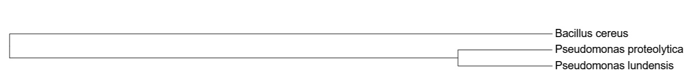

# TreeMS2

## Description

TreeMS2 is a scalable, open-source Python tool that computes pairwise distances between sets of tandem mass
spectrometry (MS/MS) spectra by comparing the spectra directly. Peptides, proteins and metabolites do not need to be
identified first, so the results don't depend on complete reference databases or spectral libraries. The resulting
distance matrix can be used to build phylogeny-like trees or low-dimensional embeddings (e.g. PCA, UMAP) of molecular
phenotypes.

Key features:

- **Annotation-independent**: works on raw MS/MS spectra, including spectra that cannot
  be annotated.
- **Scalable**: spectrum vectorization combined with approximate nearest-neighbour search scales near-linearly in
  practice, to thousands of MS runs and millions to hundreds of millions of spectra.
- **Multi-modal**: the same workflow applies to proteomics (including single-cell proteomics) and metabolomics data,
  acquired in data-dependent (DDA) or data-independent (DIA) mode.
- **Flexible grouping**: multiple MS runs (e.g. technical replicates or LC-MS/MS fractions) can be combined into a
  single biological group.

TreeMS2 is designed to support applications such as:

- Molecular phylogenetics
- Species identification
- Food and feed authentication
- Quality control and detection of sample mix-ups in large-scale MS studies

### How it works

1. **Preprocessing**: spectra are filtered for noise and quality (m/z range, precursor peak removal, low-intensity
   peaks, minimum number of peaks), then intensities are scaled and normalized.
2. **Vectorization**: each spectrum is binned into a sparse vector and reduced to a dense low-dimensional vector
   using sparse random projections, which approximately preserves cosine similarity.
3. **Indexing and search**: vectors are stored per precursor charge in [Lance](https://lance.org/)
   vector stores and indexed with [Faiss](https://github.com/facebookresearch/faiss). For each spectrum, approximate
   nearest neighbours above a cosine similarity threshold and within a precursor m/z window are kept.
4. **Distance computation**: the similarity between two groups is the mean of (a) the fraction of spectra in group A
   with at least one match in group B and (b) the fraction of spectra in group B with at least one match in group A.
   Each similarity *s* is converted into a distance, giving a symmetric distance matrix.

### Input

TreeMS2 requires the following input files:

- **MGF files**: one or more Mascot Generic Format (MGF) files containing MS/MS spectra. Vendor RAW files can be
  converted to MGF with, for example, [ThermoRawFileParser](https://github.com/compomics/ThermoRawFileParser).
- **A metadata file (CSV or TSV)**: a table with the columns `file` and `group` that maps each MGF file to a
  user-defined group label. A group can contain spectra from multiple MGF files. File paths in the metadata file must
  be relative to the location of the metadata file.

Each group is then compared with all other groups to compute a distance matrix.

An example of a valid TSV file:

```
file        group
file1.mgf   Gorilla
file2.mgf   Gorilla
file3.mgf   Chimpanzee
file4.mgf   Macaque
```

## System requirements

### Operating system and Hardware

TreeMS2 has been tested and developed on Linux. TreeMS2 runs on a standard desktop computer; no non-standard hardware is
required. Memory and runtime requirements grow with the number of spectra. TreeMS2 adapts its index compression to the
available
memory.

### Software dependencies

All dependencies are installed through the Conda environment defined in [`environment.yml`](environment.yml). TreeMS2
has been tested with the following versions:

| Package         | Version |
|-----------------|---------|
| Python          | 3.12.12 |
| NumPy           | 1.26.4  |
| SciPy           | 1.15.2  |
| pandas          | 2.2.3   |
| scikit-learn    | 1.7.2   |
| Numba           | 0.62.1  |
| faiss-gpu-cuvs  | 1.10.0  |
| pylance (Lance) | 0.24.0  |
| spectrum_utils  | 0.4.2   |
| Pyteomics       | 4.7.5   |
| joblib          | 1.4.2   |
| ConfigArgParse  | 1.7.1   |
| psutil          | 7.1.3   |
| python-dotenv   | 1.2.1   |
| tqdm            | 4.67.1  |
| matplotlib      | 3.10.8  |

Optional external tools used in the example workflow:

- [ThermoRawFileParser](https://github.com/compomics/ThermoRawFileParser) to convert Thermo RAW files to MGF.
- [MEGA 11](https://www.megasoftware.net) to construct trees from the MEGA distance matrix.
- [iTOL](https://itol.embl.de) to visualize the resulting trees.

## Usage

### Installing the Conda environment

To get started with TreeMS2, it's recommended to use the provided Conda environment to ensure all dependencies are
correctly installed.

Clone the repository:

```bash
git clone https://github.com/bittremieuxlab/TreeMS2.git
cd TreeMS2
```

Create and activate the Conda environment:

```bash
conda env create -f environment.yml
conda activate TreeMS2
```

Installing the Conda environment can take a couple of minutes on a normal desktop computer, depending mostly on
the internet connection speed. TreeMS2 itself requires no further installation or compilation.

### Configuration and Environment variables

To request an overview of the available parameters:

```bash
python3 -m TreeMS2 --help
```

Additionally, some environment variables specific to TreeMS2 can be set:

- `TREEMS2_NUM_CPUS`: Specifies how many CPU threads TreeMS2 should use.
- `TREEMS2_MEM_PER_CPU`: Memory in GB per core/cpu that TreeMS2 is allowed to use.

Some other environment variables, used by dependencies of TreeMS2:

Lance:

- `LANCE_IO_THREADS`
- `LANCE_CPU_THREADS`

NumPy, SciPy, BLAS, etc.:

- `MKL_NUM_THREADS`
- `NUMEXPR_NUM_THREADS`
- `BLIS_NUM_THREADS`
- `OPENBLAS_NUM_THREADS`
- `NUMBA_NUM_THREADS`

In general it is not necessary to set the environment variables explicitly, the application will determine appropriate
settings automatically.

### Running TreeMS2

Run the program by either providing a configuration file or by providing the required arguments:

```bash
python3 -m TreeMS2 -c config.ini
```

### Output

TreeMS2 generates several output files during execution, but the most important result is the pairwise distance matrix
between all sets of spectra. It is saved in two formats in `<work_directory>/results/`:

- `distance_matrix.meg`: the distance matrix in MEGA format, a human-readable format used by the MEGA (Molecular
  Evolutionary Genetics Analysis) software (version 11). MEGA can be used to construct a rooted tree using the UPGMA
  algorithm (Phylogeny → Construct/Test UPGMA Tree → Pairwise Distance → Lower Left Matrix).
- `distance_matrix.npy`: the full, symmetric *n* × *n* distance matrix in NumPy binary format, for downstream analyses
  in
  Python (e.g. clustering, PCA, UMAP or tree construction with SciPy).
- `labels.txt`: the group labels, one per line, in the same order as the rows and columns of `distance_matrix.npy`.

For example, to load the distance matrix and its labels in Python:

```python
import numpy as np

distances = np.load("<work_directory>/results/distance_matrix.npy")
with open("<work_directory>/results/labels.txt") as f:
    labels = [line.rstrip("\n") for line in f]
```

## Example

This section walks through a small end-to-end run of TreeMS2: four bacterial MS/MS runs are compared and the resulting
distance matrix is turned into a tree.

### 1. Download the example data

The example uses 3 randomly selected files from the *Pseudomonas* dataset and 1 file from the *Bacillus* dataset,
available
on [MassIVE](https://massive.ucsd.edu) under dataset identifier
[MSV000096603](https://massive.ucsd.edu/ProteoSAFe/dataset.jsp?accession=MSV000096603) (Abele, M., Soleymaniniya, A.,
Bayer, F.P., Lomp, N., et al., *Proteomic Diversity in Bacteria: Insights and Implications for Bacterial
Identification*. Mol. Cell. Proteomics 2025,
24, 100917. [doi:10.1016/j.mcpro.2025.100917](https://doi.org/10.1016/j.mcpro.2025.100917)).

| File                          | Dataset     | Download                                                                                |
|-------------------------------|-------------|-----------------------------------------------------------------------------------------|
| `BBM_334_P110_25_DDA_012.raw` | Pseudomonas | ftp://massive-ftp.ucsd.edu/v07/MSV000096603/raw/Pseudomonas/BBM_334_P110_25_DDA_012.raw |
| `BBM_334_P110_25_DDA_015.raw` | Pseudomonas | ftp://massive-ftp.ucsd.edu/v07/MSV000096603/raw/Pseudomonas/BBM_334_P110_25_DDA_015.raw |
| `BBM_334_P110_25_DDA_016.raw` | Pseudomonas | ftp://massive-ftp.ucsd.edu/v07/MSV000096603/raw/Pseudomonas/BBM_334_P110_25_DDA_016.raw |
| `BBM_338_P110_28_DDA_003.raw` | Bacillus    | ftp://massive-ftp.ucsd.edu/v07/MSV000096603/raw/Bacillus/BBM_338_P110_28_DDA_003.raw    |

From the root of the cloned TreeMS2 repository, create a directory for the example and download the files into it:

```bash
mkdir -p example/raw example/mgf example/myworkdir
cd example/raw
wget ftp://massive-ftp.ucsd.edu/v07/MSV000096603/raw/Pseudomonas/BBM_334_P110_25_DDA_012.raw
wget ftp://massive-ftp.ucsd.edu/v07/MSV000096603/raw/Pseudomonas/BBM_334_P110_25_DDA_015.raw
wget ftp://massive-ftp.ucsd.edu/v07/MSV000096603/raw/Pseudomonas/BBM_334_P110_25_DDA_016.raw
wget ftp://massive-ftp.ucsd.edu/v07/MSV000096603/raw/Bacillus/BBM_338_P110_28_DDA_003.raw
cd ../..
```

### 2. Convert the RAW files to MGF

TreeMS2 reads MGF files, so the Thermo RAW files first need to be converted, for example with
[ThermoRawFileParser](https://github.com/compomics/ThermoRawFileParser) (available via Bioconda as
`thermorawfileparser`). Output format `-f 0` produces MGF:

```bash
ThermoRawFileParser -d example/raw -o example/mgf -f 0
```

### 3. Create the sample-to-group file

Create `example/mgf/sample_to_group.tsv` in the same directory as the MGF files, mapping each MGF file to its group
(here: the species). Columns are tab-separated:

```
file	group
BBM_334_P110_25_DDA_012.mgf	Pseudomonas lundensis
BBM_334_P110_25_DDA_015.mgf	Pseudomonas proteolytica
BBM_334_P110_25_DDA_016.mgf	Pseudomonas proteolytica
BBM_338_P110_28_DDA_003.mgf	Bacillus cereus
```

The two *Pseudomonas proteolytica* runs are combined into a single set of spectra, so the resulting distance matrix
compares three groups.

### 4. Create the configuration file

Create `example/config.ini`. Set `sample_to_group_file` to the path of the `sample_to_group.tsv` file created above and
`work_dir` to the (existing) work directory `example/myworkdir`. Relative paths are resolved against the directory from
which TreeMS2 is run (here: the repository root); absolute paths work as well.

```ini
# IO Arguments
sample_to_group_file = example/mgf/sample_to_group.tsv
work_dir = example/myworkdir
overwrite = false
incremental_compaction = true

# Spectra Preprocessing Arguments
fragment_tol = 0.05
min_peaks = 5
min_mz_range = 250.0
min_mz = 101.0
max_mz = 1500.0
remove_precursor_tol = 1.5
min_intensity = 0.01
max_peaks_used = 50
scaling = root

# Vectorization
low_dim = 400

# Indexing and search
use_gpu = false
batch_size = 100000
num_neighbours = 100
num_probe = 32

# Post-filtering
similarity = 0.8
precursor_mz_window = 2.05

# Logging
log_level = INFO
```

The resulting directory layout should look like this:

```
TreeMS2/                      # repository root
├── example/
│   ├── config.ini
│   ├── raw/                  # downloaded .raw files
│   ├── mgf/
│   │   ├── BBM_334_P110_25_DDA_012.mgf
│   │   ├── BBM_334_P110_25_DDA_015.mgf
│   │   ├── BBM_334_P110_25_DDA_016.mgf
│   │   ├── BBM_338_P110_28_DDA_003.mgf
│   │   └── sample_to_group.tsv
│   └── myworkdir/            # TreeMS2 work directory
└── TreeMS2/                  # TreeMS2 source code
```

### 5. Run TreeMS2

Activate the Conda environment (see [Installing the Conda environment](#installing-the-conda-environment)) and run
TreeMS2 from the repository root:

```bash
conda activate TreeMS2
python3 -m TreeMS2 -c example/config.ini
```

Progress is printed to the console; log files are written to `example/myworkdir/logs/`.

The expected run time of this example on a normal desktop computer is a few minutes (excluding downloading and
converting the RAW files).

### 6. Inspect the results

TreeMS2 outputs the distance matrix in the MEGA (`.meg`) file format, a human-readable format used by the
[MEGA](https://www.megasoftware.net) software suite (Molecular Evolutionary Genetics Analysis), as well as in NumPy
binary format (`.npy`) for downstream use:

- `example/myworkdir/results/distance_matrix.meg`: distance matrix in MEGA format (MEGA 11)
- `example/myworkdir/results/distance_matrix.npy`: distance matrix in NumPy format
- `example/myworkdir/results/labels.txt`: group labels corresponding to the rows and columns of the NumPy matrix

The expected `distance_matrix.meg` should look similar to this:

```
#mega
TITLE: example/mgf/sample_to_group.tsv (similarity threshold=0.8, precursor m/z window=2.05))

#Pseudomonas_lundensis
#Pseudomonas_proteolytica
#Bacillus_cereus


3.6900
20.2427	22.2357
```

Because TreeMS2 uses approximate nearest-neighbour search, values
may differ slightly between runs or machines.

### 7. Build and visualize a tree

The MEGA file can be imported in MEGA (version 11) to construct a rooted tree from the distance matrix using the UPGMA
algorithm:

1. In MEGA 11, go to **Phylogeny → Construct/Test UPGMA Tree**.
2. Select the distance matrix in MEGA format (`distance_matrix.meg`).
3. Select **Pairwise Distance** and **Lower Left Matrix**.

MEGA then computes the tree. To export it, use **File → Export Current Tree (Newick)** and tick **Branch Lengths** and
**Node Labels**.

The resulting Newick file can be uploaded to [iTOL](https://itol.embl.de) (Interactive Tree Of Life) for interactive
visualization.

The resulting tree for this example separates *Bacillus cereus* from the two *Pseudomonas* species:



## Reproducing the manuscript analyses

The input files for the analyses in the manuscript are available on Zenodo:
[doi:10.5281/zenodo.24347634](https://doi.org/10.5281/zenodo.24347634). For each analysis (38SPD bacterial proteomics,
38SPD with dairy isolates, kingdom of life, single-cell proteomics and Global FoodOmics), the `TreeMS2-inputs/`
directory contains:

- a TreeMS2 configuration file (`.ini`) with the parameters used in the manuscript, and
- a sample-to-group file (`.tsv`) that maps each MS run to its group.

To rerun an analysis:

1. Download the RAW files of the corresponding public dataset (dataset identifiers are listed in the manuscript).
2. Convert the RAW files to MGF, e.g. with ThermoRawFileParser (see [the example](#2-convert-the-raw-files-to-mgf)).
3. Place the sample-to-group file in the same directory as the MGF files. File names in this file are relative to its
   location.
4. In the configuration file, set `sample_to_group_file` to the path of the sample-to-group file and `work_dir` to an
   existing, empty work directory.
5. Run TreeMS2 with this configuration file:

   ```bash
   conda activate TreeMS2
   python3 -m TreeMS2 -c <analysis>-config.ini
   ```

The resulting distance matrices can then be compared with the distance matrices provided in the `data/` directory on
Zenodo. Run times for the full datasets range from about 2 to 13 hours (see Supplementary Table 1 in the manuscript).

## Considerations and known issues

### Interpreting the results

- **Distances are approximate.** Random projections and approximate nearest-neighbour search trade some accuracy for
  speed. Increasing `num_neighbours` and `num_probe` makes the search more exhaustive, but slower.
- **Spectra are only compared within the same precursor charge** (1, 2, 3, ≥ 4 and undefined), and only when their
  precursor m/z values fall within `precursor_mz_window`.
- **Data quality affects the distances.** Groups with low spectral quality, contamination (e.g. from a growth medium or
  food source) or sample mix-ups can appear far from their expected neighbours. This makes TreeMS2 useful for quality
  control, but unexpected placements should be checked before drawing biological conclusions.

### Parameters

- **Default parameters are tuned for proteomics data.** For metabolomics data, lowering `min_mz` (e.g. to 50) and
  `min_mz_range` (e.g. to 100) is recommended.

### Known issues

- **GPU support is less thoroughly tested.** Development and testing were mainly done on CPU. Additional testing on GPU
  is needed, especially for larger datasets. With `use_gpu = true`, `num_neighbours` and `num_probe` are limited to a
  maximum of 2048.
- **Only MGF input is supported.** Vendor RAW files and other formats (e.g. mzML) have to be converted to MGF first.

## Acknowledgements

TreeMS2 is inspired by and builds upon the similarity concept introduced in compareMS2:

- Palmblad, M., Deelder, A.M., Molecular phylogenetics by direct comparison of tandem mass spectra. *Rapid Commun. Mass
  Spectrom.* 2012, 26, 728–732.
- Marissen, R., Varunjikar, M.S., Laros, J.F.J., Rasinger, J.D., et al., compareMS2 2.0: An Improved Software for
  Comparing Tandem Mass Spectrometry Datasets. *J. Proteome Res.* 2023, 22, 514–519.

TreeMS2 relies on several open-source projects, including [Faiss](https://github.com/facebookresearch/faiss),
[Lance](https://github.com/lancedb/lance), [spectrum_utils](https://github.com/bittremieux-lab/spectrum_utils),
[Pyteomics](https://github.com/levitsky/pyteomics), [NumPy](https://numpy.org), [SciPy](https://scipy.org) and
[Numba](https://numba.pydata.org).
